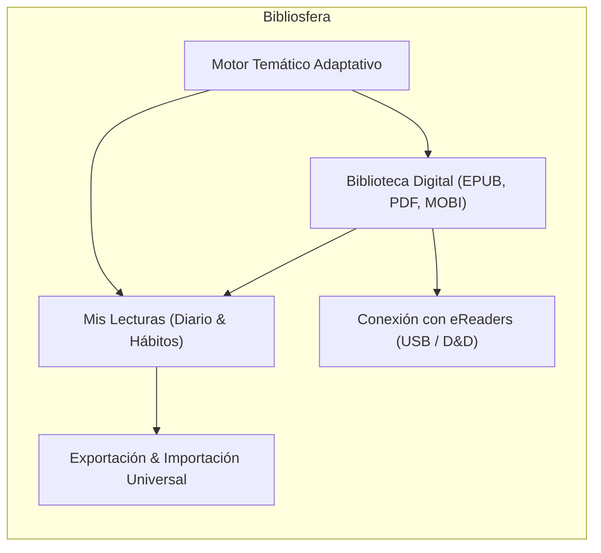
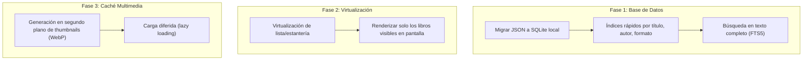

# Análisis Integral de Bibliosfera: Producto, Rendimiento, Comercialización y Futuro

---

## 1. Visión General y Estado Actual del Producto

**Bibliosfera** ha evolucionado rápidamente desde un gestor de lecturas hasta convertirse en una **plataforma híbrida de biblioteca táctil y diario de lecturas personal**. Combina dos necesidades que tradicionalmente estaban separadas en el ecosistema digital:

1. **Gestión de archivos y e-books físicos/digitales** (lo que tradicionalmente hacía Calibre de forma puramente técnica).
2. **Registro de hábitos, valoraciones y estadísticas visuales** (lo que hacen plataformas sociales como Goodreads o StoryGraph, pero sin privacidad ni control local).



### Funcionalidades destacadas ya operativas:
- **Doble módulo integrado:** Transición fluida entre «Mis lecturas» (historial leído y opiniones) y «Biblioteca digital» (libros disponibles para leer).
- **Vistas múltiples de la biblioteca:**
  - *Estantería táctil:* Portadas 3D con perspectiva física y sombras ambientales.
  - *Lomos de libros:* Representación proporcional según número de páginas y colores armónicos.
  - *Lista clásica:* Vista densa para filtrado rápido por formato y estado.
- **Detección y transferencia a eReaders (Plug & Play):**
  - Reconocimiento de unidades USB montadas (Kindle, Kobo, carpetas personalizadas).
  - Zona de arrastrar y soltar (*drag & drop*) que copia archivos físicos directamente a la memoria del lector.
- **Extracción de metadatos y portadas en local:**
  - Descompresión nativa de archivos EPUB (`container.xml`, `content.opf`) extrayendo título, autor, fecha y portada sin depender de herramientas externas.
  - Soporte de consulta complementaria a OpenLibrary / Google Books para sinopsis y páginas.
- **Exportación e Importación universal:**
  - Soporte de **Excel (.xlsx)**, **PDF imprimible**, **CSV**, **Markdown** y **JSON**.
  - Capacidad de importar carpetas completas analizando decenas de e-books en masa.
- **Diseño de interfaz y sistema de temas:**
  - Identidad visual cuidada y tipografía editorial (`Bricolage Grotesque` + `DM Sans`).
  - Tres temas visuales completos con variantes clara y oscura: **Elegante**, **Cactusito** y **Ex Libris**.

---

## 2. Análisis de Rendimiento y Arquitectura Técnica

### Puntos fuertes actuales:
- **Tecnología moderna:** El binomio **Electron + Vite + React + Tailwind CSS** proporciona recargas instantáneas en desarrollo y empaquetado optimizado mediante Rollup/Vite.
- **Proceso IPC desacoplado:** Las operaciones pesadas del sistema de archivos (lectura de carpetas, descompresión de EPUBs, copia a USB) se ejecutan en el proceso principal de Node (`main`), manteniendo la interfaz gráfica ágil.
- **Zero-Cloud / Privacidad Total:** Todos los datos se guardan en el disco del usuario (`appData` y carpetas locales). No hay latencia de red ni riesgo de filtración de datos personales.

### Cuellos de botella detectados en la arquitectura actual:

| Componente | Implementación Actual | Impacto Potencial en Rendimiento |
| :--- | :--- | :--- |
| **Persistencia** | Archivos planos `JSON` leídos y sobreescritos al completo (`fs.writeJSON`) | Eficiente hasta ~1.000 libros. Con colecciones mayores, reescribir un archivo de varios megabytes en cada edición genera pausas I/O. |
| **Renderizado de listas** | Mapeo directo en React (`map()`) sin virtualización de nodos | Con más de 200–300 libros cargados simultáneamente en pantalla, el DOM almacena demasiados nodos y elementos 3D pesados. |
| **Imágenes y portadas** | Rutas locales directas a archivos temporales o base64 | Si no hay miniaturas cacheadas de tamaño uniforme (thumbnails), Electron decodifica imágenes de alta resolución en memoria. |
| **Búsqueda** | Filtrado lineal con `String.includes()` en memoria | Rápido para unos cientos de libros; carece de tolerancia a erratas o búsqueda ponderada por sinopsis. |

---

## 3. Plan de Escalabilidad (Hacia colecciones de 5.000+ libros)

Para transformar la aplicación en una herramienta capaz de gestionar colecciones monumentales (como las bibliotecas de Calibre con más de 10.000 libros), la hoja de ruta de escalabilidad técnica debe centrarse en tres pilares:



1. **Migración a SQLite embebido (`better-sqlite3`):**
   - Elimina la sobreescritura de archivos JSON completos.
   - Permite consultas instantáneas paginadas (`LIMIT 50 OFFSET 0`).
   - Habilita la búsqueda en texto completo instantánea mediante **SQLite FTS5** (incluso buscando en las sinopsis completas).
2. **Virtualización del DOM (`@tanstack/react-virtual`):**
   - En la vista de lista y en la estantería, solo se renderizan los libros que caen dentro del viewport visible del usuario, reduciendo el consumo de memoria RAM de Electron en más del 70%.
3. **Caché optimizada de miniaturas de portadas:**
   - Al importar un libro, generar una versión ligera en formato `WebP` de 300px de altura para las estanterías y guardar la original solo para el detalle del libro.

---

## 4. Viabilidad de Comercialización y Modelo de Negocio

### El hueco en el mercado: "El Obsidian/Craft de los libros"

El mercado actual del software de libros está polarizado entre dos extremos:

```
[ HERRAMIENTAS TÉCNICAS ]                          [ PLATAFORMAS SOCIALES ]
   Calibre (potente, fea,                              Goodreads / StoryGraph
   antigua, abrumadora)                               (social, cerrado, sin archivos)
                   \                                         /
                    \                                       /
                     ★ HUECO DE MERCADO DE BIBLIOSFERA ★
                       - Estética editorial prémium
                       - Privacidad y propiedad de tus datos
                       - Conexión con eReaders físicos
                       - Experiencia visual y táctil
```

### Propuesta de Valor Única (UVP):
> *"Tu biblioteca y tus lecturas en un único santuario digital: elegante, privado, táctil y conectado a tu eReader."*

### Modelos de monetización recomendados:

1. **Licencia de Pago Único (Pay-once, keep forever - Modelo indie):**
   - **Precio sugerido:** 19 € – 29 € (pago único con 1 año de actualizaciones mayores gratuitas).
   - Este modelo tiene un enorme prestigio y fidelidad en comunidades de lectores y usuarios de Mac/escritorio (similar a aplicaciones como *Typora*, *Things 3*, *Obsidian Sync*, *Craft* o *Scrivener*).
2. **Modelo Freemium:**
   - **Versión Gratuita:** Gestión de lecturas ilimitada, biblioteca de hasta 50 libros, exportación básica.
   - **Versión Pro (Pago único):** Sin límite de biblioteca, sincronización masiva a eReaders, exportación a PDF editorial diseñado, temas exclusivos y estadísticas avanzadas.
3. **Requisitos clave para lanzar al mercado:**
   - **Firma y Notarización de Apple:** Esencial para que macOS no muestre la advertencia de "desarrollador no identificado".
   - **Empaquetado multiplataforma:** Compilar instaladores nativos para **macOS (Intel + Apple Silicon)** y **Windows (x64)** con `electron-builder`.

---

## 5. Hoja de Ruta: Mejoras que Enriquecerían la Experiencia

### Prioridad Alta (Impacto inmediato en la experiencia de lectura):
- **Lector de e-books integrado básico:**
  - Poder hacer doble clic en cualquier libro de la estantería y abrir una ventana de lectura minimalista (modo tipografía agradable, cambio de tamaño de letra y guardado de página actual), sin obligar a abrir otra app del sistema.
- **Sincronización de progreso con eReaders (Kobo / Kindle):**
  - Leer el archivo de estado de lectura de Kobo (`KoboReader.sqlite`) para actualizar automáticamente el porcentaje leído en Bibliosfera al conectar el dispositivo por USB.
- **Detección inteligente de duplicados:**
  - Al importar carpetas grandes, avisar al usuario si un libro ya existe por coincidencia de título/autor o hash criptográfico (MD5/SHA256).

### Prioridad Media (Enriquecimiento de datos y personalización):
- **Citas, notas y reflexiones por libro:**
  - Un apartado dentro de cada libro para guardar citas favoritas o notas de lectura (estilo *Readwise*), con opción de exportarlas en formato Markdown a bóvedas de Obsidian o Notion.
- **Metadatos enriquecidos con búsqueda asistida:**
  - Botón de "Autocompletar metadatos": escribe el título y la app consulta Google Books / OpenLibrary para descargar portada oficial en alta definición, sinopsis original, páginas exactas, saga y género literario con un clic.
- **Metas y retos de lectura anuales:**
  - Widget opcional en "Mis lecturas" con un reto anual (ej. "Meta 2026: 24 libros") y barra de progreso animada.

### Prioridad Avanzada (Ecosistema y sincronización):
- **Copia de seguridad en la nube del usuario:**
  - Compatibilidad directa para guardar la biblioteca en iCloud Drive, Dropbox o Google Drive sin necesidad de servidores propietarios.
- **Generador de fichas de lectura compartibles:**
  - Botón para exportar una tarjeta visual de resumen de una lectura terminada en formato imagen cuadrada/story para compartir en Instagram, Mastodon o Twitter.

---

## Resumen Ejecutivo

Bibliosfera tiene los cimientos de un producto excepcional: **identidad visual refinada**, **utilidad real** que soluciona el abismo entre la gestión de archivos y el seguimiento de hábitos, y **respeto por la privacidad del usuario**.

El salto de "excelente proyecto personal" a "producto comercializable de éxito" pasa principalmente por:
1. **Afianzar la robustez técnica en colecciones masivas** (SQLite + miniaturas optimizadas).
2. **Empaquetar y firmar la app para macOS y Windows**.
3. **Añadir el lector integrado ligero** para cerrar el círculo completo de lectura.
